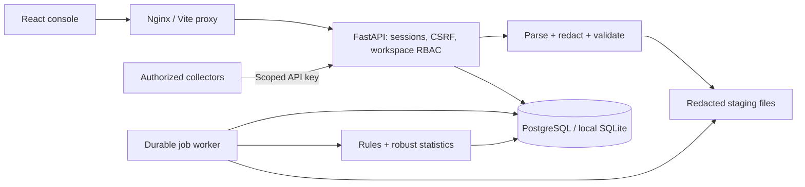

# LogSentinel AI

Private, explainable log anomaly detection for authorized defensive monitoring. A working FastAPI + React application with persistent events, secure workspace access, resumable ingestion, versioned detections, investigation workflows and a responsive light/dark console.

> An anomaly is an observation, not proof of malicious intent. Tune detection to your environment and verify evidence with the system owner. LogSentinel never scans targets, attacks systems, blocks IP addresses or disables accounts.

## What works

- Administrator, analyst, viewer and source-administrator roles, enforced by the API.
- Argon2id passwords, hashed server-side sessions, CSRF protection, login throttling, single-use password recovery and session invalidation.
- Isolated workspaces with source-scoped, revocable ingestion keys.
- File imports for `.log`, `.txt`, `.json`, `.jsonl` and `.csv`; safe previews, explicit CSV mapping, partial-import choice, progress, row errors and duplicate counts.
- Linux/SSH, Nginx/Apache, JSON, key-value, generic application and basic Windows-export parsers.
- Redaction before staging/storage, pseudonymous identifiers, privacy controls and safe exports.
- Sixteen detection types: rules, sequences, source silence and robust statistical baselines with minimum-history guards, versions and human-readable reasoning.
- Alert lifecycle, assignment, notes, tags, evidence timelines, related events and audit history.
- Real database metrics, search, saved views, source health, notifications and queued CSV/JSON reports.
- Durable database-backed jobs with leases, progress checkpoints and bounded retries.
- Retention previews, explicitly enabled daily cleanup and deletion audit summaries.
- Keyboard-operable controls, responsive navigation, chart data tables, persistent light and dark themes.

## Architecture



Python 3.12+, FastAPI, Pydantic 2, SQLAlchemy 2, Alembic, PostgreSQL 17; React 19, TypeScript, Vite, TanStack Query, Recharts and Lucide. The custom CSS design system uses native accessible controls. SQLite is a local convenience; production configuration requires PostgreSQL and HTTPS. No paid service, external AI provider or Redis is required.

## Local setup

Prerequisites: Python 3.12+, Node 24, npm and Git. Run from the repository root. On Windows, use `npm.cmd` if PowerShell blocks `npm.ps1`.

```powershell
python -m venv .venv
.venv\Scripts\python -m pip install -r requirements.lock
.venv\Scripts\python -m pip install --no-deps -e .
python scripts/init_env.py
python scripts/manage.py db:upgrade
npm.cmd --prefix frontend ci
```

Linux/macOS: replace `.venv\Scripts\python` with `.venv/bin/python`; use `npm` normally. `scripts/manage.py` finds the virtual environment automatically.

Run these commands in three terminals:

```text
python scripts/manage.py dev
python scripts/manage.py worker
npm run dev
```

Open **http://localhost:5173**. The first visit to `/login` creates the installation's administrator and workspace. Public setup closes immediately afterward. API docs: **http://localhost:8000/api/docs**. Liveness: `/api/health`; database/worker readiness: `/api/ready`.

### Optional synthetic demo

```text
python scripts/manage.py db:seed
```

This explicit, idempotent development command creates about 10,900 synthetic events, four sources, normal history, a login burst and success sequence, HTTP error spike, parser failures, alerts and investigation context. It refuses to run in production.

| Role | Development email |
| --- | --- |
| Administrator | `admin@logsentinel.example.com` |
| Analyst | `analyst@logsentinel.example.com` |
| Viewer | `viewer@logsentinel.example.com` |
| Source administrator | `source@logsentinel.example.com` |

All demo accounts use **`Sentinel-Demo-2026!`**. These are public development fixtures. Use a fresh database for production; never deploy demo accounts with these credentials.

## Docker quickstart

```text
python scripts/init_env.py --docker
docker compose --env-file .env.docker up -d --build
```

Open **http://localhost:8080** and complete first-admin setup. Compose starts PostgreSQL, a one-shot Alembic migration, API, worker and Nginx console. Database and staging volumes persist across restarts. Optional demo: `docker compose --env-file .env.docker exec backend logsentinel seed`.

Do not use `docker compose down -v` on an installation whose data you need. See [deployment](docs/deployment.md) for HTTPS, secrets, backups and production settings.

## Configuration

See [.env.example](.env.example). `scripts/init_env.py` generates fresh secrets and never overwrites an existing file.

| Variable | Purpose |
| --- | --- |
| `DATABASE_URL` | SQLAlchemy database URL; Compose supplies PostgreSQL internally |
| `SECRET_KEY` | Stable random value, at least 32 characters; protects entity fingerprints |
| `PUBLIC_ORIGIN` | Exact browser origin: local `http://localhost:5173`, Docker `http://localhost:8080`, production HTTPS origin |
| `ENVIRONMENT` | `development` or `production` |
| `COOKIE_SECURE` | `true` in production; requires HTTPS |
| `POSTGRES_PASSWORD` | Fresh URL-safe database password for Compose |
| `UPLOAD_MAX_BYTES` | Default 10 MiB, plus a bounded multipart envelope |
| `SESSION_HOURS` | Default 12 hours |
| `SMTP_*` | Optional operator-configured password-reset email relay |

Without SMTP, the operator can generate a one-time recovery link after verifying account ownership:

```text
.venv/Scripts/python -m app.cli reset-link person@example.com
```

The output is sensitive and expires after 30 minutes. Do not paste it into shared logs or issues. Existing-account workspace grants are available through the local `grant-member` command after identity verification.

## Development and verification

```text
python scripts/manage.py test -q
python scripts/manage.py lint
python scripts/manage.py format
python scripts/manage.py typecheck
.venv/Scripts/python scripts/verify_migrations.py
npm test
npm run lint
npm run typecheck
npm run build
npm --prefix frontend run format:check
npm --prefix frontend exec -- playwright install chromium
npm run test:e2e
```

Browser tests start an isolated disposable backend, worker and frontend; they do not modify the development database. To generate a migration: `python scripts/manage.py db:migrate -m "describe schema change"`. Additional backend commands: `start`, `test:watch`, `db:upgrade`, `db:seed`, `worker`. Frontend commands also include `preview`, `test:watch` and `format`.

GitHub Actions runs backend/console checks, clean migrations, PostgreSQL integration tests and Chromium workflows. See [testing](docs/testing.md) and the [actual verification record](docs/final-verification.md).

## Documentation

[Implementation plan](docs/implementation-plan.md) · [Architecture](docs/architecture.md) · [Database](docs/database-schema.md) · [API](docs/api.md) · [Ingestion](docs/ingestion.md) · [Parsers](docs/parsers.md) · [Detection](docs/detection-engine.md) · [Alerts](docs/alert-workflow.md) · [Security](docs/security.md) · [Privacy](docs/privacy.md) · [Operations](docs/operations.md) · [Deployment](docs/deployment.md) · [Responsible use](docs/anti-abuse-policy.md).

## Practical limits and future work

This is a self-hosted monitoring application, not a certified SIEM or a guarantee of detection. Imports are capped at 10 MiB / 100,000 records, REST batches at 1,000 records, event pages at 100 results and report evidence at 10,000 events. JSON arrays are decoded within the upload limit; line formats stream. Parsing/redaction happens during bounded upload validation; database ingestion and detection run in the worker.

No outbound webhooks, local collector, PDF reports, raw-log persistence, SSO/MFA, external AI summaries, arbitrary regex rules, geolocation inference, seasonal models, event partitioning or multi-region orchestration are included. The existing fields support service scoping; statistical baselines are per source. Reports explicitly identify their event filters and workspace context scope. Add these capabilities only with corresponding security controls and tests. See [final verification](docs/final-verification.md) for limitations and results.
